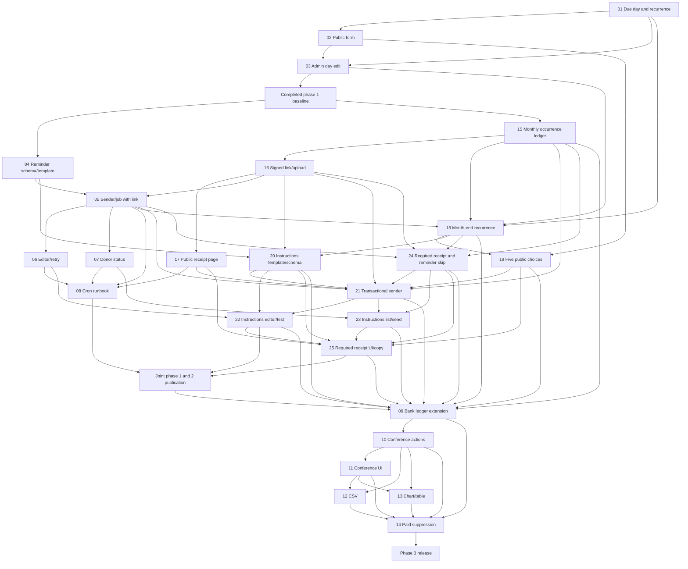

# Donor Payment Journey, Reminders, and Reconciliation — Task List

## Tasks

| # | Title | Type | Status | Complexity | Dependencies |
|---|-------|------|--------|------------|--------------|
| 01 | Add due-day schema and recurrence rules | backend | completed | high | — |
| 02 | Reorder Pix and conditional donor submission | frontend | completed | high | task_01 |
| 03 | Edit monthly due day in donor administration | frontend | completed | medium | task_01, task_02 |
| 04 | Persist reminder template and send records | backend | completed | high | task_03 |
| 05 | Implement reserved reminder delivery and daily job | backend | completed | high | task_04, task_16 |
| 06 | Manage reminder template, preview, test, and failed retries | frontend | completed | high | task_05 |
| 07 | Show next due and last reminder in the donor list | frontend | completed | medium | task_05 |
| 08 | Document and schedule the daily reminder job | other | completed | medium | task_05, task_06, task_07, task_17 |
| 09 | Extend occurrence ledger for bank conference | backend | pending | high | task_08, task_15, task_18, task_19, task_20, task_21, task_22, task_23, task_24, task_25 |
| 10 | Implement bank conference actions and totals | backend | pending | high | task_09 |
| 11 | Build administrator payment conference screen | frontend | pending | high | task_10 |
| 12 | Export selected payment conference as CSV | backend | pending | medium | task_10, task_11 |
| 13 | Chart expected and received amounts by month | frontend | pending | medium | task_10, task_11 |
| 14 | Suppress reminders for bank-confirmed credits | backend | pending | medium | task_09, task_10, task_11, task_12, task_13 |
| 15 | Materialize minimal monthly payment occurrences for phase 2 | backend | completed | high | task_03 |
| 16 | Sign receipt links and attach monthly evidence | backend | completed | high | task_15 |
| 17 | Build the public monthly receipt page | frontend | completed | medium | task_16 |
| 18 | Support days through 31 and month-end recurrence | backend | completed | high | task_01, task_03, task_05, task_15 |
| 19 | Require five monthly due-day choices and explain emailed payment | frontend | completed | high | task_02, task_18 |
| 20 | Persist monthly instructions template and send history | backend | completed | high | task_04, task_16, task_18 |
| 21 | Send monthly instructions after successful registration | backend | completed | high | task_05, task_15, task_16, task_17, task_19, task_20, task_24 |
| 22 | Manage monthly instructions template in admin | frontend | completed | high | task_06, task_20, task_21 |
| 23 | Show monthly instructions status and manual send in donor list | frontend | completed | high | task_07, task_21, task_24 |
| 24 | Track required monthly receipts and skip remaining reminders | backend | completed | high | task_05, task_15, task_16, task_18 |
| 25 | Explain required receipts in donor and admin interfaces | frontend | completed | high | task_17, task_19, task_20, task_22, task_23, task_24 |

## Dependency Graph and Release Gates

Tasks 01–08 and 15–25 are completed baseline and phase-2 amendment work; task 09 waits for the joint phase-1/2 publication gate. Each task includes targeted tests. The joint gate's `npm test` and production build passed locally for task 25; install the cron line only after the image, required receipt-link upload check, and email tests succeed in the publication workflow. Phase 2 records each monthly receipt as pending until uploaded, without a bank-conference screen. Phase 3 adds that screen and bank-confirmation fields to the same occurrence rows.
